  

  <a href="https://marceloandradedev.vercel.app">portfólio</a>
  &nbsp;·&nbsp;
  <a href="https://www.linkedin.com/in/dev-marcelo-leal/">linkedin</a>
  &nbsp;·&nbsp;
  <a href="https://www.instagram.com/marcelo0.0/">instagram</a>

### Oi, eu sou o Marcelo

Dev fullstack pleno, formado em Análise e Desenvolvimento de Sistemas. Gosto de pegar uma ideia e levar até o fim: a tela em React ou Next.js, a API em NestJS ou Spring Boot, o banco, o container e o deploy. Quando dá problema em produção, também sou eu que vou atrás.

### IA, do jeito que funciona

Boa parte do meu tempo hoje vai para fazer agentes de IA trabalharem direito. Isso passa por RAG, por servidores MCP e, principalmente, por contexto bem montado. Construí uma memória técnica central que os agentes consultam antes de mexer no código, e ela otimizou bastante o uso deles no time.

Se quiser trocar ideia sobre agentes, RAG ou MCP, é só chamar.

### Com o que eu trabalho

  
   
  

e no meio do caminho: n8n, Evolution API, Caddy e uma boa dose de terminal.

### Por aqui

  

<picture>
  <source media="(prefers-color-scheme: dark)" srcset="https://raw.githubusercontent.com/DevMarceloAndrade/DevMarceloAndrade/output/snake-dark.svg"/>
  
</picture>
